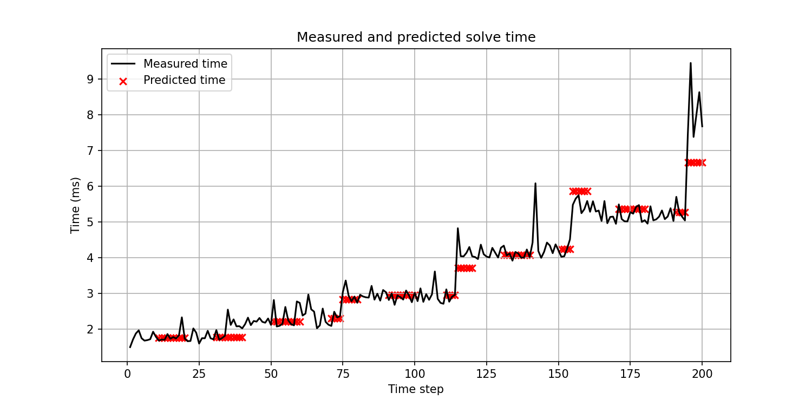
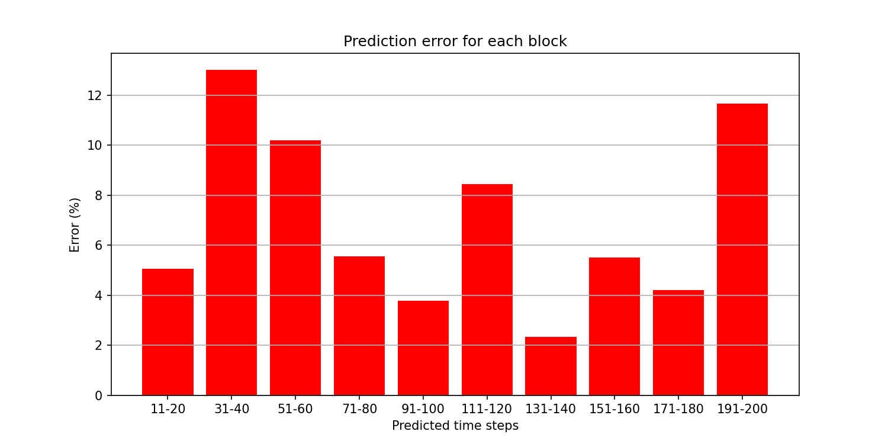

# Predicting PARDISO Solve Time

This project predicts how long PARDISO takes to solve a sparse matrix, before
running it, using linear regression.

In a CFD simulation, a matrix is solved at every timestep, and this often takes
most of the time. Knowing the solve time beforehand helps to plan the run, check
if more grid points would make it too slow, and pick a different solver if needed.

## How it works

- **Test matrices:** 2000 x 2000, changing over 200 timesteps. A new band is added
  at steps 35, 75, 115, 155 and 195.
- **Features:** number of nonzeros and bandwidth.
- **Solve time:** full PARDISO solve (through `pypardiso`), median of 21 runs.
- **Run 10, predict 10:** steps 1-10 are solved and timed, then steps 11-20 are
  predicted. Then 21-30 are run, 31-40 predicted, and so on until step 200.

## Results

Average prediction error: about **7%**.





## How to run

```
pip install numpy scipy pandas matplotlib scikit-learn pypardiso
python predict_solve_time.py
```
